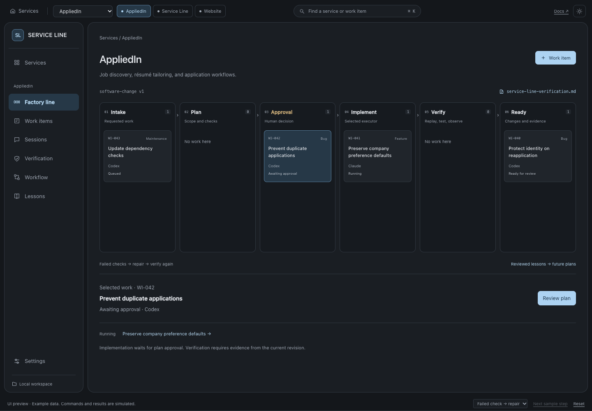

# Service Line

A software factory for bugs, features, refactors, and maintenance.

Choose an executor, approve a plan, and follow the work through implementation,
verification, and repair. Each service keeps its own work items, session context,
and reviewed lessons.

**Status:** interactive UI prototype and architecture proposal. Executor adapters,
the workflow engine, durable storage, and real verification are not implemented.
The mock UI uses sample data and resets on reload.

[Documentation](https://sayantan94.github.io/service-line/docs/) ·
[Runtime design](https://sayantan94.github.io/service-line/design/) ·
[Try the mock UI](https://sayantan94.github.io/service-line/service-line-ui.html)



## How it works

**Intake → Plan → Human approval → Implement → Verify → Ready**

The customer selects Codex or Claude. Approval binds the plan, its risk level, and
the required checks. Failed checks return to bounded repair; missing evidence stops
progress. Ready means the change has evidence for review, not that it has been
merged or deployed.

That line is one of four loops in the design:

| Loop | Purpose |
|---|---|
| **Change** | Take one work item from Intake to Ready. |
| **Observe** | After deployment, check that the change behaves as the plan expected. |
| **Maintain** | Scan the repository on a schedule and propose work items. |
| **Learn** | Turn past work into reviewed context and lessons. |

Risk level sets how deep verification goes and how much human review Ready needs.
Every level keeps human plan approval. See the [workflow contract](docs/workflow.md).

## Six primitives

| Primitive | Responsibility |
|---|---|
| **Instance** | One service's repository, working folder, defaults, and local lessons. |
| **Work item** | One requested outcome, its criteria, plan, approval, sessions, and runs. |
| **Workflow** | A versioned ASL-style definition of states, transitions, and limits. |
| **Executor** | A coding-agent adapter: Codex or Claude. The customer picks the implementer; the other one verifies. |
| **Session** | A persistent agent conversation with its own `context.md` and history. |
| **Run** | One workflow execution, including its checkout, event log, checks, and evidence. |

[Primitive definitions and ownership](docs/primitives.md) ·
[Workflow contract](docs/workflow.md) ·
[Runtime](docs/runtime.md) ·
[Verification](docs/verification.md) ·
[Context and learning](docs/context-and-learning.md) ·
[Dreaming](docs/dreaming.md)

## Verification

Every service owns a versioned `service-line-verification.md`. It specifies startup
and reset, test commands, browser actions, traffic replay, expected outcomes, and
required observations. A different executor from the implementer follows this guide; the
engine checks the evidence against the approved plan and current code snapshot.

[Template for a service](templates/service-line-verification.md) ·
[This prototype's guide](service-line-verification.md)

## Try locally

Open `service-line-ui.html` in a browser from this checkout. No installation or account is required.
`service-line.html` is the standalone architecture document.

The **Factory** view gives each service a floor. Select a workstation or work item
to inspect its state, open its session, or review its checks. **Line** opens the
same service as a stage-by-stage board. Both views share the same sample state.

Select **AppliedIn**, open **WI-042**, approve the sample plan, and use
**Next sample step** to follow a failed check through repair. Try **Missing
evidence** to see the gate block progress. **Reset** restores the examples.

The New service form demonstrates Claude drafting a description and test command.
It uses a bundled example; it does not read arbitrary folders or call Claude.

## Repository

```text
docs/                              Documentation and mock UI screenshots
assets/factory-floor.css            Spatial view styles
assets/factory-floor.js             Spatial view of the shared sample state
workflows/software-change.asl.json  Proposed workflow; no runtime included
workflows/post-deploy-observe.asl.json  Proposed observe loop; no runtime included
templates/                         Per-service verification template
service-line-ui.html               Interactive mock UI
service-line.html                  Standalone architecture document
design/                            Runtime design: one overview diagram and a page per part
service-line-verification.md       Verification contract for this prototype
```

GitHub Pages builds the Markdown documentation with the layout in `_layouts/`.
The UI loads its spatial view from `assets/`; keep that directory beside the HTML
when opening it locally. See [Contributing](CONTRIBUTING.md) for editing and verification.
