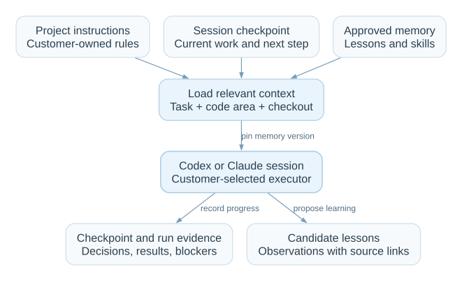

# Context and learning

Each service should retain what it learns about its codebase. A new work item
starts with relevant project knowledge. An interrupted session resumes from a
checkpoint. Repeated failures become reviewed lessons that improve later work.

Learning changes the context and procedures supplied to Codex or Claude. It does
not train model weights. The customer chooses the executor; Service Line owns the
memory and its lifecycle.

> This is the runtime design. The current prototype shows sample lessons and
> sessions; it does not persist memory or run the learning loop.

## What the executor remembers

| Material | What it answers | Example |
|---|---|---|
| **Project instructions** | What rules apply here? | Use the service's test command and code conventions. |
| **Session context** | Where did this work stop? | The patch is written; the retry check still fails. |
| **Lessons** | What should future work account for? | A timeout can occur after a submission succeeds. |
| **Skills** | How do we perform a recurring task? | Replay a timeout, retry, and check for duplicate records. |
| **Run state and evidence** | What actually happened? | Plan v2 was approved; check output belongs to revision r3. |

Project instructions are customer-owned. Session context is working memory.
Lessons capture reusable knowledge; skills turn proven procedures into steps with
inputs, expected results, and failure handling. Structured run state remains the
authority for approvals and completion.

## During a work item

<div class="concept-diagram" role="region" tabindex="0" aria-label="Context loading diagram; scroll horizontally if needed" markdown="1">



</div>

At planning or resume, read a small memory index and retrieve only entries relevant
to the task, code area, and current checkout. Loading every transcript would fill
the context window with unrelated or stale information. Record the memory version,
lesson IDs, and skill versions used by each run.

`session.json` identifies the executor and native conversation. `context.md`
records the goal, decisions, changed files, evidence links, blockers, and next
step. `history.jsonl` retains the underlying events. Update the checkpoint at
meaningful milestones and before a handoff; reconcile it with the checkout and
structured run state before resuming.

Implementation and verification use separate sessions. A provider switch starts
a new native conversation with a recorded handoff. Shared reviewed knowledge can
be reused; an implementation conversation is not the verifier's context.

## Filesystem memory

Memory lives in the instance's working folder, independently of a provider's
conversation history. An executor adapter exposes scoped list, search, read, and
write operations. A dedicated memory tool and ordinary filesystem tools can use
the same store. Service Line controls paths and write permissions.

Sessions write their own context and candidates. Approved lessons and skills are
read-only to normal work sessions. Reading a note does not make it a project rule,
an approval, or evidence that a check passed.

```text
instances/appliedin/
├── instance.yaml
├── learning/
│   ├── lessons.md                 # index of approved lessons
│   ├── candidates/                # observations awaiting review
│   ├── consolidations/            # input versions, proposed diffs, validation
│   ├── versions/                  # retained approved memory snapshots
│   └── skills/                    # approved reusable procedures
└── workitems/WI-001/
    ├── workitem.md
    ├── plans/v1.md
    ├── approvals/v1.json
    ├── workspace/
    ├── runs/run-001/
    │   ├── state.json
    │   └── artifacts/
    └── sessions/
        ├── implementation/        # session.json, context.md, history.jsonl
        └── verification/          # separate conversation and checkpoint
```

Local storage does not mean offline execution. The chosen executor receives the
context needed for its session. Memory remains scoped to its service; cross-service
reuse requires an explicit, reviewed copy.

## Between work items: dreaming

**Dreaming** is a consolidation job that reviews several completed or stopped
runs together. It finds patterns a single session may miss and keeps retained
memory useful as the codebase changes.

[Read the full dreaming concept](dreaming.md): what it learns, the lifecycle,
evaluation, publication, and an AppliedIn example.

<div class="concept-diagram" role="region" tabindex="0" aria-label="Learning loop diagram; scroll horizontally if needed" markdown="1">


</div>

1. **Capture.** Save corrections, failures, successful repairs, and unresolved
   observations as candidates with links to the source runs and evidence.
2. **Consolidate.** Snapshot current memory and selected histories. Merge duplicate
   lessons, flag contradictions, and propose retiring stale entries. Keep isolated
   observations scoped until evidence supports broader reuse.
3. **Validate.** Test technical claims and proposed skills against regression
   cases, replay fixtures, or browser journeys in an isolated checkout. Missing
   evidence leaves a candidate unvalidated. A human preference needs explicit
   review, rather than a fabricated technical test.
4. **Review.** Show a memory diff, source evidence, affected scope, and validation
   results. A human can approve, edit, or reject it. Edits to technical procedures
   require validation again.
5. **Publish.** Make an approved version available to future runs. Preserve old
   versions and histories so a lesson can be disabled, superseded, or rolled back.

Run consolidation on demand or on a configured schedule, with session, time, and
token limits. Use the customer's executor and the existing workflow, session, and
run primitives. A failed or canceled job never publishes a partial memory store.

Each candidate records its sources, scope, proposed change, validation, and review
status. Sessions write separate candidates; one writer publishes per instance.
Publication checks that its input memory version is still current. If it changed,
reconcile and review the new diff. Active runs keep their recorded memory version
and approved plan.

## From lesson to skill

For an AppliedIn retry bug, the progression could be:

| Step | Retained result |
|---|---|
| Observation | A timeout was followed by a duplicate submission. |
| Verified lesson | This submission path needs an idempotency check before retrying. |
| Reviewed skill | Replay the timeout and retry, inspect browser recovery, and assert that one application record exists. |
| Reuse | A later plan loads the lesson and includes the relevant verification steps. |

Promote a procedure after it succeeds on representative cases. A skill explains
how to do the work; `service-line-verification.md` defines the required evidence.
Changing that guide or an approved plan still requires normal review and approval.

## Check that learning helps

Compare representative tasks with and without candidate memory before promotion.
Track repeated failures, repair attempts, human corrections, completion rate,
latency, and token cost. Monitor later runs for regressions and disable harmful
lessons. Saving more notes alone does not demonstrate improvement.

Memory cannot weaken required checks, bypass approval, or override customer
instructions. The objective is fewer repeated mistakes with traceable evidence.
