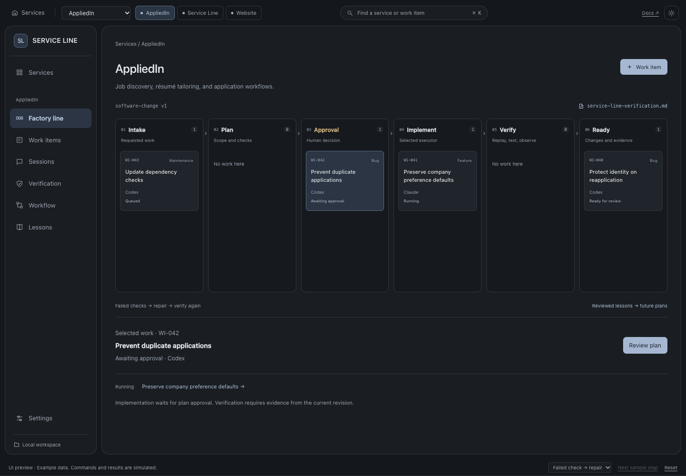

# Service Line

A software factory for bugs, features, refactors, maintenance, and new products.
The customer chooses the executor and approves the plan. Service Line coordinates
the work, requires evidence, and retains useful context locally.

> This repository contains an interactive prototype and a proposed architecture.
> It does not run agents, execute tests, replay traffic, or change product repositories.

## The factory line

<ol class="flow"><li>Intake</li><li>Plan</li><li>Approval</li><li>Implement</li><li>Verify</li><li>Ready</li></ol>

Select a service, then follow its work items through the line. Open an item to
review its plan, sessions, changes, and evidence. A failed check returns it to
repair. Missing evidence stops progress. Ready means ready for review.

[Open the mock UI](../service-line-ui.html)

## Start with the model

- [Primitives](primitives.md): the six objects and what each owns.
- [Workflow](workflow.md): approval, execution, repair, and resumption.
- [Verification](verification.md): browser actions, replay, observations, and gates.
- [Context and learning](context-and-learning.md): session memory and reusable lessons.
- [Try the prototype](getting-started.md): the controls and current limits.

The expected benefit is less repeated explanation and manual coordination.
Approved work can proceed through checks and repairs while the customer focuses
on scope, decisions, and results. Productivity gains remain to be measured once
the runtime exists.
